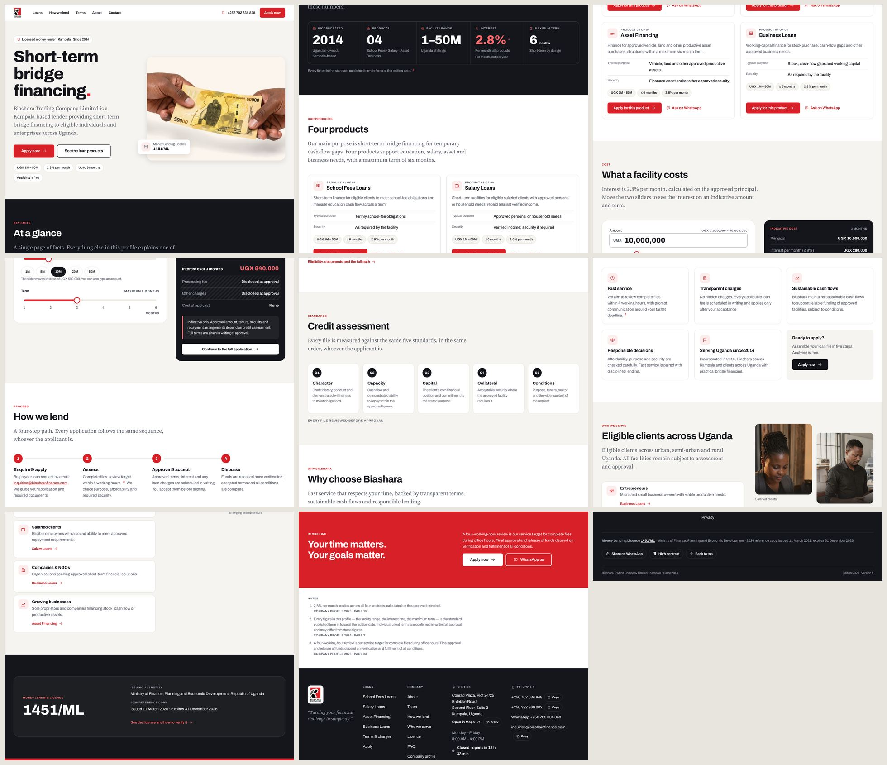
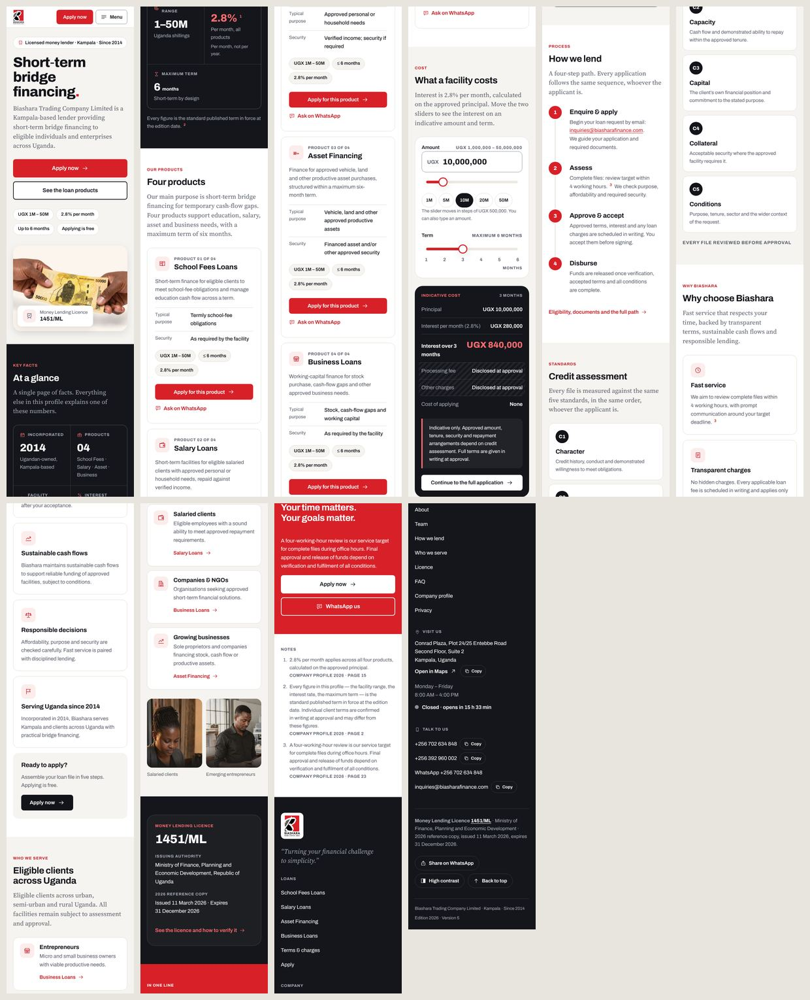
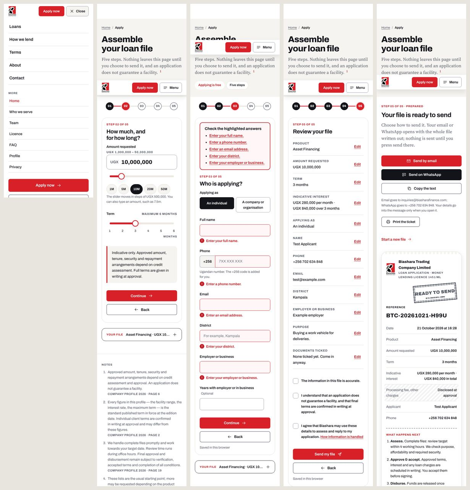
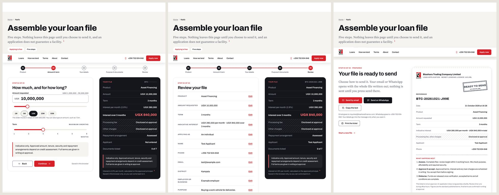

# Biashara website: redesign prototype

**Status:** built and tested. Sections 1–11 are the specification written before the build; section 12 records what was built, the measured results and the changes made while building.
**Scope:** every page, PC and mobile. Content, facts and disclaimers are unchanged; only the design, layout, styles and scripts change.
**Site:** Biashara Trading Company Limited, short-term bridge financing, Kampala.

---

## 1. Why redesign

A review of the live site (scrolled the way a visitor does, on a 390 px phone and a 1280 px desktop) found problems that come from the design concept itself, not from a few wrong values:

| # | What was wrong | Where | Effect |
|---|---|---|---|
| 1 | Page was built from root paths and published in a sub-folder | Whole site on GitHub Pages | No images, no styles, no scripts (fixed earlier, `BASE_PATH`) |
| 2 | **Products section scrolled sideways while the page scrolled down** (pinned horizontal scroll) | Home, Products | Panels cut in half mid-scroll ("LOANS", "ASSET FINA"), long dead scroll, feels broken on touch |
| 3 | Smooth-scroll library replaced native scrolling | Whole site | Scrolling felt slow and "unresponsive"; breaks anchor links, find-in-page and some phones |
| 4 | 2.6 s loading animation covered the page on first visit | Every first visit | Nothing readable for about 4 s; looks like a hang |
| 5 | Page-transition curtain, custom cursor with "DRAG" / "VIEW" tags, grid overlay, command palette | Whole site | Labels floated over text; extra layers of fragile CSS and script |
| 6 | Print-ledger furniture: side rail, folio strip, crop marks, colour bars, registration marks, grain and vignette overlays | Every page | Visual noise; the fixed back-to-top button covered content; less usable space on phones |
| 7 | Giant outline numerals ("01"–"04") clipped at the screen edge; ticker text cut off at the left | Home | Looked like a rendering bug |
| 8 | 12-column helper classes (`s-6 o-7 md-s-12`) on every block | All templates | Layout defined in markup; easy to break on a new screen size |
| 9 | Eight cascade layers plus a separate inline "critical" copy of the styles | CSS | Hard to reason about; the same rule in two places |
| 10 | Body copy only in a serif with two weights; bundled sans only had bold weights | Type | No clean regular sans for forms, tables and small text |

**Goal:** a calm, fast, conventional lender website that is obviously trustworthy, reads well on a small phone and uses a big screen well, and cannot "break" because it does not depend on scroll tricks.

---

## 2. Design principles

1. **Content first.** A visitor can read, scroll and tap within the first second. No intro, no hijacked scroll.
2. **Mobile first, desktop enhanced.** Every layout is written for a 320 px phone first, then widened at breakpoints. Nothing scrolls sideways at any width.
3. **Trust through clarity.** Plain labels, real numbers, the licence number visible, charges stated without decoration. One clear red action per screen area.
4. **One system.** A small set of tokens (colour, type, spacing, radius, shadow) and a small set of components. No one-off values in pages.
5. **Native behaviour.** Normal links, normal scrolling, native `<details>` for accordions, native form controls where possible.
6. **Fails safe.** Works without JavaScript (all content, navigation, FAQ, the contact details and an email/phone route for applying).
7. **Accessible by default.** WCAG 2.1 AA: contrast, focus, keyboard, 44 px touch targets, reduced motion.

---

## 3. Brand and design tokens

### 3.1 Colour

The logo red is unchanged (`#D82028`, sampled from the logo file).

| Token | Value | Use | Contrast |
|---|---|---|---|
| `--red` | `#D82028` | Primary buttons, accents, icons | white on red **5.05:1** |
| `--red-deep` | `#B3161D` | Button hover/active | white on red-deep **6.89:1** |
| `--red-text` | `#C41C24` | Red text and links on light | on white **5.93:1**, on surface **5.40:1** |
| `--red-tint` | `#FDECEC` | Soft red background (chips, callouts) | ink on tint **16.12:1** |
| `--red-on-dark` | `#FF6B70` | Red text on dark | on night **6.54:1** |
| `--ink` | `#12141A` | Headings, body text | on white **18.41:1** |
| `--slate` | `#565B66` | Secondary text | on white **6.81:1**, on surface **6.20:1** |
| `--bg` | `#FFFFFF` | Page | |
| `--surface` | `#F6F4F0` | Alternate sections, cards on white | warm paper, keeps the brand feel |
| `--surface-2` | `#ECE9E3` | Pressed/selected surfaces | slate on it **5.62:1** |
| `--line` | `#E2DED6` | Hairlines, card borders | decorative |
| `--line-strong` | `#8A8F99` | Input borders (UI component, needs 3:1) | on white **3.25:1** |
| `--night` | `#14161B` | Dark sections, footer | white on night **18.10:1**, muted `#A9AEB8` **8.13:1** |
| `--green` | `#14733F` | "Open now" | on white **5.91:1**, on night (`#52C985`) **8.66:1** |

Rules: red is used for actions, key figures and small accents, not for large background areas, except the closing call-to-action band. Never red text smaller than 14 px on a tinted background.

### 3.2 Type

| Role | Family | Weight | Size (fluid) | Line height |
|---|---|---|---|---|
| H1 | Archivo | 800 | `clamp(2.25rem, 1.6rem + 3vw, 4rem)` = 36 → 64 px | 1.05, tracking −0.025 em |
| H2 | Archivo | 700 | `clamp(1.75rem, 1.35rem + 1.6vw, 2.75rem)` = 28 → 44 px | 1.12 |
| H3 | Archivo | 700 | `clamp(1.25rem, 1.1rem + 0.6vw, 1.5rem)` = 20 → 24 px | 1.25 |
| Lede | Source Serif 4 | 400 | `clamp(1.1875rem, 1.05rem + 0.6vw, 1.5rem)` = 19 → 24 px | 1.5 |
| Body | Archivo | 400 | 16 px (17 px from 1024) | 1.6 |
| UI / buttons | Archivo | 600 | 16 px | 1 |
| Small | Archivo | 400 | 14 px | 1.5 |
| Eyebrow / label | Archivo | 700, uppercase, +0.08 em | 12 px | 1.3 |
| Figures | Archivo | 800, tabular numbers | `clamp(2rem, 1.4rem + 2.6vw, 3.5rem)` | 1 |

Fonts are self-hosted: **Archivo variable (weights 100–900, replacing the bold-only subset)**, Source Serif 4 and Source Serif 4 Italic (unchanged). Three files in total. Inputs are always 16 px or larger so phones do not zoom on focus.

### 3.3 Space, shape, depth

- **Spacing scale (4 px base):** 4, 8, 12, 16, 24, 32, 48, 64, 96, 128. Section padding `clamp(56px, 32px + 5vw, 112px)`.
- **Container:** max 1200 px, side padding `clamp(20px, 4vw, 40px)`; reading column 720 px.
- **Radius:** 8 px (buttons, inputs), 16 px (cards), 24 px (hero photo), 999 px (chips).
- **Shadow:** `--shadow-1: 0 1px 2px rgba(18,20,26,.06)`; `--shadow-2: 0 8px 24px rgba(18,20,26,.08)`. Cards use a 1 px border first, shadow only on hover.
- **Focus ring:** 3 px solid `--ink` with 2 px white gap (on dark: white). Visible on every interactive element.
- **Motion:** 150–250 ms ease-out, only on colour, shadow and transform. No scroll-triggered animation, no scroll-linked effects. `prefers-reduced-motion` removes all transitions.

### 3.4 Breakpoints and grid (mobile first, `min-width`)

| Name | Width | What changes |
|---|---|---|
| base | 320–599 | One column; stacked buttons; menu button |
| `sm` | 600 | Two-column card grids; side-by-side buttons |
| `md` | 768 | Two-column text + image layouts; tables show as tables |
| `lg` | 1024 | **Desktop navigation appears**; 3-column grids; sticky side summaries |
| `xl` | 1280 | Full hero layout; 4/5-column rows |
| `2xl` | 1536 | Container stays 1200 px; hero type reaches its maximum |

Layouts use CSS Grid with named, reusable classes (`.grid-2`, `.grid-3`, `.split`, `.cards`). Page templates do not carry column numbers.

---

## 4. Global components

### 4.1 Header (sticky)

```
MOBILE (390)                                DESKTOP (1280)
+----------------------------------+        +------------------------------------------------------------+
| [logo]            [Apply] [ ☰ ]  | 64 px  | [logo]  Loans  How we lend  Terms  About  Contact   ☎ 0702 634 848  [Apply now] | 72 px
+----------------------------------+        +------------------------------------------------------------+
```

- White, 1 px bottom line, becomes `--shadow-1` after 8 px of scroll (CSS + 6 lines of script; stays visible without it).
- **Menu (below 1024 px):** a full-height panel slides down under the header with the five links, the full page list in a second group, the phone number and "Apply now". Closes on Esc, on link tap and on a tap outside. Focus is kept inside while open; the page behind does not scroll. **Without JavaScript** the same links show as a wrapping row under the logo.
- Current page is marked (`aria-current="page"`, red underline on desktop, red bar on mobile).
- The header never hides on scroll (no direction-based show/hide).

### 4.2 Buttons and links

- **Primary** red fill, white text, 48 px high (44 px minimum), 8 px radius; hover `--red-deep`; pressed moves down 1 px.
- **Secondary** white fill, ink border; **Ghost** text with arrow; **On dark** white fill with ink text.
- Button rows stack full width on mobile, sit inline from `sm`.
- Text links are underlined (offset 3 px), red-text colour, arrow icon for "go to" links.

### 4.3 Cards, chips, callouts

- **Card:** white (or surface on white sections), 1 px `--line` border, 16 px radius, 24 px padding (20 px on phones).
- **Chip:** pill, 36 px high, surface fill, used for key facts (`UGX 1M–50M`, `2.8% per month`, `Up to 6 months`, `Applying is free`).
- **Callout:** surface fill, 4 px red left bar, used for the required disclaimers ("Indicative only…", "An application does not guarantee a facility…"). Never hidden or collapsed.
- **Icon tile:** 44 px rounded square, red-tint fill, red line icon from the existing sprite.

### 4.4 Accordion

Native `<details><summary>`: 56 px high summary row, number + question + plus icon that rotates; panel text 16 px. Used for FAQ and Core values. No script.

### 4.5 Tables

Real tables from `md` (768) up. Below that each row becomes a labelled card (`data-label` shows beside each value). No horizontal scrolling tables except the long profile document, where the table sits in a focusable scroll region.

### 4.6 Footer (dark)

```
DESKTOP                                                      MOBILE
+-------------------------------------------------------+    +------------------------+
| [logo]  “Turning your financial challenge             |    | [logo]                 |
|          to simplicity.”                              |    | “Turning your…”        |
|                                                       |    | ---------------------- |
| Loans        Company       Visit us        Talk to us |    | Visit us   (address)   |
| School Fees  About         Conrad Plaza…   0702 …     |    | Open now · closes 4 PM |
| Salary       Team          Mon–Fri 8–4     0392 …     |    | Talk to us (phones…)   |
| Asset        Licence       ● Open now      WhatsApp   |    | Loans / Company lists  |
| Business     FAQ                           Email      |    | ---------------------- |
|                                                       |    | Licence 1451/ML …      |
| Money Lending Licence 1451/ML · Ministry of Finance…  |    | [WhatsApp][Contrast][↑]|
| [Share on WhatsApp] [High contrast] [Back to top]     |    +------------------------+
+-------------------------------------------------------+
```

Copy buttons for address, phones and email are kept. The licence-expiry notice (`data-licence-guard`) is kept.

### 4.7 Page header (all inner pages)

```
+----------------------------------------------------------------+
| Home / Loans                         (breadcrumb, 14 px)       |
| Our loan solutions                   H1                        |
| One-paragraph lede in serif                       [optional    |
| [chip] [chip] [chip]                               photo/aside]|
+----------------------------------------------------------------+   surface background
```

Mobile: single column, photo (if any) below the lede. Desktop: text 7 columns, aside 5 columns.

### 4.8 Back to top and announcer

A single 48 px round "back to top" button, bottom-right, appears after two screens of scrolling, stays clear of the sticky Apply bar on phones. A visually hidden live region announces copy confirmations.

---

## 5. Page prototypes

Section order below is the order on screen. "M" = mobile (390), "D" = desktop (1280). All text comes from the current pages, word for word.

### 5.1 Home `/`

1. **Hero** (surface). D: text 6 cols left, photo 6 cols right (4:3, 24 px radius) with a small white licence card (`Money Lending Licence 1451/ML`) overlapping the photo's lower-left corner. M: text, then buttons (full width), then photo, then four chips in a 2 × 2 grid.
   - Eyebrow: `Licensed money lender · Kampala · Since 2014` (chip)
   - H1: `Short‑term bridge financing.`
   - Lede: the Kampala‑based lender paragraph.
   - Buttons: `Apply now` · `See the loan products`
   - Chips: `UGX 1M–50M` · `2.8% per month` · `Up to 6 months` · `Applying is free`
2. **At a glance** (night). Five stat cells: 2014 · 04 · 1–50M · 2.8% (with note and footnote) · 6 months. D: one row of five. M: 2 columns, last cell spans both. Footnote line beneath.
3. **Four products** (white). D: 2 × 2 cards. M: one column. Card: icon tile, name, description, two spec rows (typical purpose, security), chip row (`UGX 1M–50M`, `≤ 6 months`, `2.8% per month`), `Apply for this product` + `Ask on WhatsApp`.
4. **What a facility costs** (surface). D: calculator inputs left (7 cols), result card right (5 cols, sticky). M: inputs, then result card. The disclaimer callout sits inside the result card.
5. **How we lend** (white). D: four step cards in a row joined by a line, step number in a red circle. M: vertical stepper with the line on the left. Link: `Eligibility, documents and the full path`.
6. **Credit assessment** (surface). Five "C" cards: D five across (or 3 + 2 at 1024), M a single-column list; each shows letter, name, one sentence.
7. **Why choose Biashara** (white). Five benefit cards: D 3 + 2, M one column; icon tile, title, text, footnote where present.
8. **Who we serve** (surface). D: text and four group rows on the left, two stacked photos on the right. M: text, photos side by side (2 columns, 4:5), then group rows with links.
9. **Licence strip** (white card on night). Licence number large, issuing authority, dates, link, expiry notice slot.
10. **Closing call-to-action** (red band). `Your time matters. Your goals matter.`, the 4‑hour paragraph, `Apply now` (white) + `WhatsApp us` (outline white).
11. **Notes** (footnotes list).

### 5.2 About `/about/`

Page header with Managing Director photo (aside). Origin and approach (reading column). **Ambition in order**: three-step horizontal path (D) / vertical (M), step one highlighted "Now". Three "row" cards (practical start, growth ambition, client-led approach). **Vision, mission and quality** on night: three quote cards (D three across, M stacked) with the one-line "direction / method / outcome" notes. **Core values**: native accordion (first open). Operating-objectives callout. Team group photo (full width, 16:7 D, 4:3 M). Next-links.

### 5.3 Loans `/loans/`

Page header with four chips (4 products, UGX 1M–50M, 2.8% per month, 6 months). **Products**: four horizontal rows (D: icon, name + text, buttons in a column; M: stacked), anchored `#school-fees #salary #asset #business`. **Six months, at most**: a static six-segment term bar (no interaction) with the product names beneath. **Product matrix**: table (D) / cards (M), then "What is fixed" and "What varies by client" side by side. **Indicative cost**: calculator. **Financing in action**: three photos in a responsive gallery with the two captions. Apply button.

### 5.4 How we lend `/how-we-lend/`

Page header. **From enquiry to disbursement**: four steps (as home). Team discussion photos (three across D, stacked M) and the "Your deadline matters" callout. **Eligibility and documents**: two panels: tick list of who is eligible; documents checklist with working checkboxes and a "Print this checklist" button (print layout kept). Two reassurance callouts. **Credit assessment**: five C cards plus three short notes. Full-width file-review photo. **Before you apply**: six yes/no questions in a form card; the answer panel appears when all are answered (nothing is stored or sent).

### 5.5 Terms and charges `/terms/`

Page header. **Anatomy of your cost**: a segmented bar (principal, interest, processing fee, other charges, applying = none) with a legend; hatched segments mean "disclosed at approval". On M the bar becomes a vertical list with coloured markers. **When you are told**: four-point timeline. **How charges are communicated**: four rows, charges callout. **Responsible lending** (night): licensing and safeguards blocks, four rows. Photo. Next-links.

### 5.6 Who we serve `/who-we-serve/`

Page header. Two photos and the "Where we work" note, four group cards with links to the matching product, assessment callout on night, colleagues photo.

### 5.7 Team `/team/`

Page header. **Board and executive**: three portraits (D three across, M two + one). **Specialist partners**: two portraits with the reconstruction caption and footnote. **Management and staff**: five portraits (D five across, M two across). Departments chips (Credit, Accounts, Operations, Support). Group photo. Next-links. Portraits are 4:5, 16 px radius, name and role beneath.

### 5.8 Licence `/licence/`

Page header. D: certificate image left (6 cols) with six numbered hotspots; details list right (6 cols), selecting a hotspot highlights its row. M: image first, details below; tapping a number scrolls to and highlights its row. "Open full size" opens the zoom viewer (zoom in/out, drag to pan, Esc to close). Renewal and verification callout. Expiry notice slot.

### 5.9 FAQ `/faq/`

Page header. Fifteen native accordions in one reading column with the profile page source under each answer. "Not answered here?" callout with phone and email.

### 5.10 Contact `/contact/`

Page header. D: contact cards (office, telephone, email, WhatsApp, products) left; dark "Working hours" card right with the live open/closed sign and the Mon–Sun strip. M: hours card first (it answers "are you open?"), then contact cards. Photo. **Enquiry form** (surface): intro left, form right (D); stacked (M). Copy buttons kept.

### 5.11 Apply `/apply/`

The conversion page, designed for one thumb.

```
MOBILE                                       DESKTOP
+---------------------------+                +----------------------------------------------+
| Assemble your loan file   |                | Assemble your loan file                      |
| (1)──(2)──(3)──(4)──(5)   | progress       | (1)──(2)──(3)──(4)──(5)                      |
| Step 02 of 05             |                | +------------------------+ +---------------+ |
| How much, and for how     |                | | Step form              | | Your file     | |
| long?                     |                | |                        | | (sticky       | |
| UGX [ 10,000,000 ]        |                | |                        | |  summary)     | |
| ——●——————  1M 5M 10M …    |                | | [Back]        [Continue]| | Product …     | |
| Term ——●—— 1 2 3 4 5 6    |                | +------------------------+ +---------------+ |
| Indicative only… (callout)|                +----------------------------------------------+
| [Back]  [Continue]        |
| ▸ Your file  UGX 10M · 3m | (collapsed summary, opens in place)
+---------------------------+
```

Five steps as today (product, amount and term, your details, purpose and documents, review) with the same validation, saved progress, "resume" prompt, honeypot, send-by-email/WhatsApp fallback and result ticket. Progress is a numbered stepper (current filled red, done with a tick). Buttons are full width on mobile with Continue on top. Without JavaScript the page shows the email / phone / WhatsApp route.

### 5.12 Company profile `/profile/`

Page header with print button. A document column (reading width) with contents list and the sixteen sections as before; tables stay tables and scroll inside their own region on small screens. Print stylesheet unchanged in behaviour.

### 5.13 Privacy `/privacy/` and 404

Privacy: page header + reading column. The text about "the opening animation" is removed, because the animation no longer exists (the privacy statement must match what the site does). 404: large "404", short message, five link cards.

---

## 6. Interaction and state specification

| Element | Behaviour |
|---|---|
| Header | Sticky; shadow after 8 px scroll; menu panel below 1024 px (see 4.1) |
| Calculator | Amount field (typed, `7.5m` shortcuts), slider, quick chips (1M, 5M, 10M, 20M, 50M), term slider 1–6. Interest = 2.8% × principal per month; total = monthly × months. Errors shown under the field. Result updates immediately (no animation). |
| Sliders | 44 px touch target, 8 px track, 28 px thumb with 3 px white ring; keyboard: arrows, Page Up/Down, Home/End |
| Accordion | Native `details`; the summary toggles; keyboard works by default |
| Forms | Labels above fields; 48 px inputs; errors in a summary at the top plus under each field; error text red-text with an icon; required fields marked in the label text, not by colour alone |
| Open now | Live Kampala-time sign: green dot "Open now · closes in …" or grey "Closed · opens …"; refreshes every 30 s |
| Licence guard | After the licence expiry date the verification notice appears on the licence page, footer and home strip |
| Copy buttons | Change to "Copied" for 1.8 s and announce it |
| High contrast | Toggle in footer; stored on the device; stronger lines and text |
| Back to top | Appears after two screens; instant (native) scroll |
| Links | Normal full-page navigation (no script routing), so the browser back button, find-in-page and anchors behave natively |
| Offline | The existing service worker stays (network first for pages), with its base path support |

Removed on purpose: preloader, page curtain, custom cursor, grid overlay, command palette, Index dialog, side rail, folio, scroll-linked animation, pinned scroll sections, marquee ticker, number "reel" animation, parallax.

---

## 7. Accessibility

- WCAG 2.1 AA: all text pairs in 3.1 meet 4.5:1; UI component borders meet 3:1.
- One `h1` per page, ordered headings, landmarks (`header`, `nav`, `main`, `footer`), skip link first.
- Focus visible everywhere; tab order follows reading order; the mobile menu traps focus and returns it.
- Touch targets ≥ 44 × 44 px (inline text links excepted); inputs ≥ 16 px.
- Colour never carries meaning alone (open/closed uses text; errors use icon + text; hatched = "disclosed" also labelled).
- Reduced motion: all transitions off. No flashing content.
- Images have descriptive `alt`, decorative ones `alt=""`; intrinsic `width`/`height` set to prevent layout shift.

## 8. Performance budget

| Item | Budget |
|---|---|
| JavaScript (gzip) | ≤ 40 KB total (was 78 KB app + vendor libraries) |
| CSS (gzip) | ≤ 28 KB |
| Fonts | 3 files, ≤ 200 KB, `font-display: swap`, 2 preloaded |
| Hero image | AVIF/WebP responsive, ≤ 120 KB at phone size, `fetchpriority="high"` |
| Layout shift | 0 (images carry dimensions) |
| Third-party requests | 0 |

## 9. Content rules that must not change

Every fact rule from the current site is kept and re-checked by `qa/static.mjs`: one rate (2.8% per month, never an annual rate), UGX 1M–50M, six months maximum, no claim of approval, the four standard disclaimers wherever figures appear, licence number 1451/ML and its dates, no invented claims. Reconstructed portraits keep their caption.

## 10. Acceptance checklist (every item must pass before release)

- [ ] 14 pages render with no console error at **320, 360, 390, 414, 600, 768, 820, 1024, 1280, 1440, 1920** px
- [ ] Zero horizontal overflow at every width above
- [ ] Every image loads (including lazy ones after scrolling); none stretched
- [ ] No element overlaps text; nothing clipped at screen edges
- [ ] Touch targets ≥ 44 px on 390 px; inputs ≥ 16 px
- [ ] axe: 0 violations on all pages at 390 and 1280
- [ ] Keyboard: skip link, menu, accordion, calculator, apply flow, licence viewer all usable without a mouse
- [ ] No-JavaScript: all content and navigation present; Apply page shows the email/phone/WhatsApp route
- [ ] Works from a domain root **and** from `/biashara/` (base-path check)
- [ ] Fact audit and static checks pass; behaviour tests pass
- [ ] Page weight within section 8

## 11. File map: old to new

| Old | New |
|---|---|
| `partials/loader.html`, `chrome.html` (index, palette, curtain, cursor, grid) | removed; small `chrome.html` (announcer, back to top) |
| `partials/header.html`, `footer.html`, `layout.html` | rewritten |
| `partials/product-panel.html`, `product-fig-*.html` | `product-card.html` |
| `partials/steps.html`, `five-cs.html` | rewritten without pinning / disclosure scripts |
| `css/*` (nine files, eight layers) | rewritten, no layers; critical inline file reduced to the header and hero |
| `js/router, motion, pinned, span, preloader, guilloche, palette, cursor, grid-overlay, chrome, odometer` | removed (`odometer.js` becomes a three-line plain-text updater) |
| `js/site.js` | new: header, menu, copy, contrast, back to top |
| `js/calculator, apply, enquiry, form-kit, licence, licence-guard, open-now` | kept, markup hooks unchanged |
| `assets/vendor/gsap, ScrollTrigger, lenis` | removed (about 136 KB) |
| `assets/fonts/archivo-wght.woff2` | full-weight Archivo (35 KB) |

## 12. As built

### 12.1 Screenshots

Home, 1280 px and 390 px (full page, contact-sheet layout):





The Apply flow on a phone (menu, step 2, validation errors, review, result ticket) and on desktop (step 2, review, result ticket):





### 12.2 Measured results

| Check | Result |
|---|---|
| Layout audit, 14 pages × 11 widths (320, 360, 390, 414, 600, 768, 820, 1024, 1280, 1440, 1920) | no sideways scrolling, nothing off-screen, no console error, no failed request, every image decodes, every link and button target at least 44 px (apart from the 32 px licence hotspots, which have a 48 px invisible hit area, and mouse-only copy buttons on desktop) |
| Behaviour tests (real browser) | **30 of 30** pass: calculator maths and limits, office-hours sign at the 8:00 and 16:00 boundaries, licence expiry notice, Apply from step 1 to the result ticket, saved progress, enquiry form, mobile menu, accordions, self-check, high contrast, back to top, sliders, no-JavaScript fallback, no sideways scroll |
| Accessibility (axe, WCAG 2.2 A/AA + best practice) | **0 violations** on all 14 pages at 1280 and 390 |
| Fact and wording rules | 13 of 13 fact rules and 8 of 8 required disclaimers pass; all 22 key facts trace to the Company Profile |
| Lighthouse, mobile, simulated slow 4G | Performance 97 (home), 99 (apply), 100 (loans), 96 (licence); Accessibility, Best practices and SEO **100** on every page tested; layout shift 0 |
| JavaScript (gzip) | **15.4 KB** (was 78 KB plus 136 KB of animation libraries) |
| CSS (gzip) | **14.0 KB** (was 20 KB) |
| Page height, home | 9,100 px on desktop and 14,800 px on a phone (was 16,500 and 18,200) |
| Portability | opens correctly **straight from disk** (double-click `index.html`), at the top of a domain, in `/biashara/` and in a deep folder (`/a/b/c/`): stylesheet, scripts, fonts, images, every internal link, the phone menu and the calculator link connect (`qa/portable.mjs`) |
| Reference integrity | 1,169 references (links, images, srcset, stylesheet `url()`, manifest icons, offline-cache entries) in the 14 pages all point at files that exist, checked on the repository root itself (`qa/references.mjs`) |

### 12.3 Changes made while building

- **Relative links everywhere:** `index.html` links to `assets/css/main.css`, `assets/js/app.js`, the fonts, images and other pages with relative paths (`../assets/…` one folder down), so the site no longer depends on where it is published and there is no setting to change when it moves. The font files are declared in the stylesheet (paths relative to it), the script is one classic (non-module) file with the settings bundled in so it also runs from disk, the manifest and the service worker work out their own folder, and script-made links use the `data-root` marker the build writes on every page. Opened from disk, folder links gain `index.html` automatically. Browsers refuse font files opened from disk, so only then do system fonts show. The 404 page keeps absolute paths (`BASE_PATH`), because a host can show it for a missing address at any depth.

- **Weights:** 600, 700 and 800 only (the specification said 650 and 750). They are standard values, the checker accepts them and the look is the same.
- **Grids:** every one-column grid uses `minmax(0, 1fr)`. Without it a long label or a no-wrap chip made a grid column wider than the screen and the whole page 33 px wider than a phone. The audit now runs at a fixed viewport width so it cannot be hidden by a phone's automatic zoom-out.
- **Header at 1024 px:** the phone number appears from 1200 px (it overflowed at 1024); the five links get tighter spacing between 1024 and 1199 px.
- **Footer:** columns rebalanced so the e-mail address wraps instead of pushing past the edge at 1024 px.
- **Apply sliders:** a latent bug from the old code was found and fixed. The sliders carry a `data-step` attribute (their step size) and the Apply script treated every `[data-step]` element as a form step, hiding the sliders. The old styles happened to override `hidden`. The script now selects `fieldset[data-step]`; a test guards it.
- **Dark sections:** cards and the calculator summary on dark backgrounds had dark text; four contrast failures found by axe were fixed.
- **Calculator summary title:** "Indicative ledger" is now "Indicative cost".
- **Loans, term:** the interactive ruler became a static six-segment bar; its instruction sentence ("Choose a product to run its marker…") was removed with it.
- **Apply header chips:** "Applying is free" and "Five steps" (no claim about how long it takes).
- **Privacy page:** the sentence about remembering "whether you have seen the opening animation" was removed; the site now remembers one setting (high contrast).
- **Build:** a `--only=home,about` flag builds chosen pages while designing; the preview server serves under the base path and no longer crashes on a missing file; texture generation and the animation libraries were removed; the rosette drawing code that the social-card generator uses moved to `build/guilloche.mjs`.
- **QA:** the old checks for a 4 px corner limit and no soft shadows belonged to the previous design and were removed; budgets tightened to 40 KB JavaScript and 28 KB CSS; behaviour tests for the removed features (loading animation, page transitions, command palette, grid overlay, index dialog) were replaced by tests for the new ones.

### 12.4 Known limits

- The licence certificate and some portraits are low resolution in the source material (unchanged; original files would fix this with no code change).
- Full-page screenshots of the lazy-loaded wide photos can capture a blank frame; in a real viewport they render (checked).
- Service-worker offline support is kept as before; it is not covered by the browser tests (they run with workers blocked).
